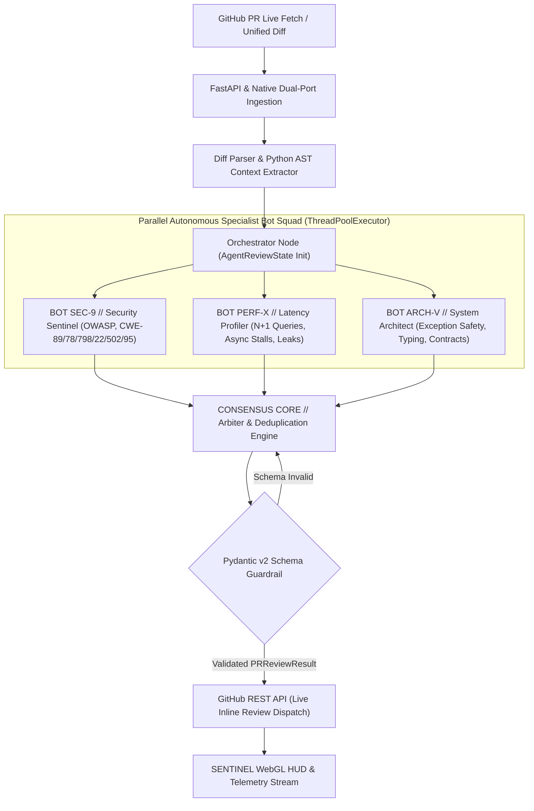

<div align="center">
  

  # SENTINEL // Autonomous Multi-Agent Pull Request Reviewer & Security Auditor

  [](https://www.python.org/downloads/)
  [](https://opensource.org/licenses/Apache-2.0)
  [](https://fastapi.tiangolo.com)
  [](https://langchain-ai.github.io/langgraph/)
  [](#interactive-sentinel-command-console)
  [](https://www.loom.com/share/de6eb4563a1d4dfb8a7a89b7b4fd3629)
  [](https://github.com/keshav647)
</div>

**SENTINEL** is an autonomous, multi-agent code intelligence and security auditing platform that integrates directly with GitHub Pull Requests via REST API and Webhooks. Rather than issuing naive, single-shot LLM calls, SENTINEL coordinates a parallel squad of specialized domain agents (`BOT SEC-9`, `BOT PERF-X`, `BOT ARCH-V`, and `CONSENSUS CORE`) using a cyclical state graph to parse unified git diffs, extract Python AST scopes, audit multi-file repositories, and dispatch line-anchored Markdown review comments with ready-to-apply `git diff` remediation patches.

---

## 🎬 Architecture Tour & Live Video Walkthrough

> **Watch the full 1080p architecture tour and live product demonstration on Loom:**  
> [](https://www.loom.com/share/de6eb4563a1d4dfb8a7a89b7b4fd3629)  
> *Direct Link:* [https://www.loom.com/share/de6eb4563a1d4dfb8a7a89b7b4fd3629](https://www.loom.com/share/de6eb4563a1d4dfb8a7a89b7b4fd3629)  
> *For the step-by-step evaluation guide and local reviewer checklist, see [Technical Walkthrough & Evaluation Guide](docs/WALKTHROUGH.md).*

---

## Architecture & State Graph



---

## Key Highlights & Engineering Signals

* **Cyclical Multi-Agent Orchestration:** Concurrent execution of Security (`BOT SEC-9`), Performance (`BOT PERF-X`), and Architecture (`BOT ARCH-V`) specialists via `PRReviewGraph`, followed by algorithmic conflict resolution and severity-weighted deduplication.
* **AST Scope & Context Extraction:** Maps unified diff hunk coordinates directly to enclosing Python AST parent nodes (`FunctionDef`, `AsyncFunctionDef`, `ClassDef`, parameter signatures, docstrings, and dangerous call/SQL f-string flags) to eliminate context-blind hallucinations.
* **Strict Pydantic v2 Schema Guardrails:** Every finding is validated against `ReviewComment` and `PRReviewResult` contracts (`file_path`, `line_number`, `severity`, `category`, `issue_summary`, `detailed_explanation`, `suggested_diff_fix`).
* **Universal Multi-Provider BYOK Gateway + Offline AST Engine:** Seamlessly routes between **Google Gemini (`gemini-2.5-flash`)**, **OpenAI (`gpt-4o-mini` / `gpt-4o`)**, **Anthropic (`claude-3-5-sonnet`)**, **Groq (`llama-3.3-70b-versatile`)**, and **OpenRouter**, with automatic key-prefix detection (`AIza*`, `sk-ant-*`, `gsk_*`, `sk-or-*`, `sk-*`) and a **$0.00 deterministic AST engine** executing in `<20ms` offline.
* **Live GitHub PR Fetch & One-Click Review Publishing:** Pulls real-time unified diffs and PR metadata from any public or private GitHub repository (`keshav647/testing #1`, `pallets/flask #5000`, etc.) and posts line-anchored inline reviews (`APPROVE`, `REQUEST_CHANGES`, `COMMENT`) directly back to GitHub.

---

## Interactive SENTINEL Command Console

The web dashboard (`src/ui/index.html`) features a bespoke **Deep Charcoal & Tactical AI Robotics** design system (`#08090c` canvas, `#0f1117` glass surfaces, Cyber Amber `#f59e0b` accents):

* ** Typography:** `Space Grotesk` (Display), `Plus Jakarta Sans` (Body), and `Space Mono` (Code & Telemetry).
* **3D WebGL & 2D Animated AI Robot Unit (`SENTINEL-01`):** Interactive **Three.js + GSAP** robot sentinel HUD with real-time state transitions (`SYS: STANDBY`, `SYS: SCANNING`, `SYS: APPROVED`, `SYS: CHANGES REQUESTED`) and an offline Cyber Scanner Visor fallback.
* **Critical Code Vulnerabilities Hotline Deck & Diff Header Hotspots:** Automatically surfaces all `CRITICAL` and `WARNING` breaches at the top of the cockpit and inside the diff header bar—clicking any card or hotspot chip isolates the file, smoothly scrolls to the exact offending line, and triggers a high-visibility row pulse.
* **Multi-File Repository Code Navigator:** Interactive file filter pills (`All Changed Codes (8)` + individual file pills with `+add / -del` stats and critical vulnerability count badges) for auditing multi-file pull requests like **Testing SENTINEL (8 Codes)**.
* **Built-In Interactive Benchmark Presets:**
  1. `[01] users.py (+12 -3)` — SQL Injection (CWE-89), Hardcoded Stripe Key (CWE-798), and N+1 query loop.
  2. `[02] analytics.py (+8 -1)` — N+1 query inside async loop and blocking `time.sleep()` event-loop stall.
  3. `[03] math.py (+4 -2)` — Clean, well-typed PR demonstrating `APPROVE` verdict.
  4. `[04] Testing SENTINEL (8 Codes)` — Full 8-file multi-module benchmark repository (`README.md`, `models/sentinel_schemas.py`, `routes/auth_sentinel.py`, `routes/diagnostics.py`, `routes/users.py`, `server.py`, `services/payment_gateway.py`, `utils/file_storage.py`).
  5. `[+] New Blank Diff` & `[>_] Edit Raw Diff` — Paste or edit any custom unified git diff on the fly.

---

## Detailed Technical Documentation

* **[System Architecture & Data Contracts](docs/ARCHITECTURE.md):** StateGraph topology, AST context mapping, comprehensive CWE rule matrix, conflict resolution math, and UI architecture.
* **[Performance & Cost Benchmarks](docs/BENCHMARKS.md):** Multi-model latency profiles, schema reliability rates, and enterprise ROI analysis.
* **[Video Walkthrough & Technical Evaluation Guide](docs/WALKTHROUGH.md):** Full 1080p Loom demonstration link, architecture tour highlights, and step-by-step reviewer checklist.

---

## Quickstart Guide

### 1. Launch from Workspace Root (Recommended)
```bash
/Users/keshavbudhiraja/AI/start_project_1.sh
```
Starts the FastAPI Uvicorn server with hot-reload at `http://127.0.0.1:8000`.

### 2. Run Dual-Port Native Server (`8000` & `8080`)
```bash
cd /Users/keshavbudhiraja/AI/project-1-pr-reviewer
python3 -m src.api.server
```
Binds simultaneously to `http://localhost:8000` and `http://localhost:8080` with zero external runtime dependencies required.

### 3. Run with Docker (Single Command)
```bash
docker compose up --build
```
The containerized service will be available at `http://localhost:8000`.

### 4. Run the Terminal CLI Showcase
Test the multi-agent system directly from your terminal:
```bash
# Run on built-in vulnerability demo
python3 -m src.cli demo

# Run on specific test fixture diffs
python3 -m src.cli review --diff tests/fixtures/sample_sql_injection.diff
python3 -m src.cli review --diff tests/fixtures/sample_performance_leak.diff
python3 -m src.cli review --diff tests/fixtures/sample_clean_pr.diff
```

---

## Running the Automated Test Suite

Run all 19 unit and integration tests across the diff parser, AST analyzer, multi-agent graph, LLM gateway provider detection, and GitHub REST client:
```bash
python3 -m unittest discover -s tests -v
```

---

## API Endpoints

| Method | Endpoint | Description |
| :--- | :--- | :--- |
| `GET` | `/` or `/ui` | Serves the interactive **SENTINEL** Web UI Console |
| `GET` | `/health` | System health check, active default model, and BYOK status |
| `POST` | `/api/v1/review` | Submit raw unified diff text for parallel multi-agent review |
| `POST` | `/api/v1/github/fetch` | Fetch live unified diff & PR metadata from GitHub (`owner/repo` or PR URL) |
| `POST` | `/api/v1/github/publish` | Dispatch structured inline review comments & verdict to a GitHub PR |

*(Note: `/api/v1/github/fetch-pr` and `/api/v1/github/publish-review` are also supported as aliases.)*

### Example cURL Request (Direct Multi-Agent Review):
```bash
curl -X POST http://localhost:8000/api/v1/review \
  -H "Content-Type: application/json" \
  -d '{
    "diff_text": "diff --git a/app.py b/app.py\n+++ b/app.py\n@@ -1,2 +1,3 @@\n+query = f\"SELECT * FROM users WHERE id = {user_id}\"\n",
    "pull_request_id": 42
  }'
```

---

## Author & Maintainer

**Keshav Budhiraja**
* Systems & AI Engineer
* **GitHub:** [@keshav647](https://github.com/keshav647)
* **Portfolio:** [keshavbudhiraja.com](https://keshavbudhiraja.com)
* **Email:** [keshavbudhiraja4321@gmail.com](mailto:keshavbudhiraja4321@gmail.com)

---

## License

This project is licensed under the [Apache 2.0 License](LICENSE).

Copyright (c) 2026 Keshav Budhiraja.
