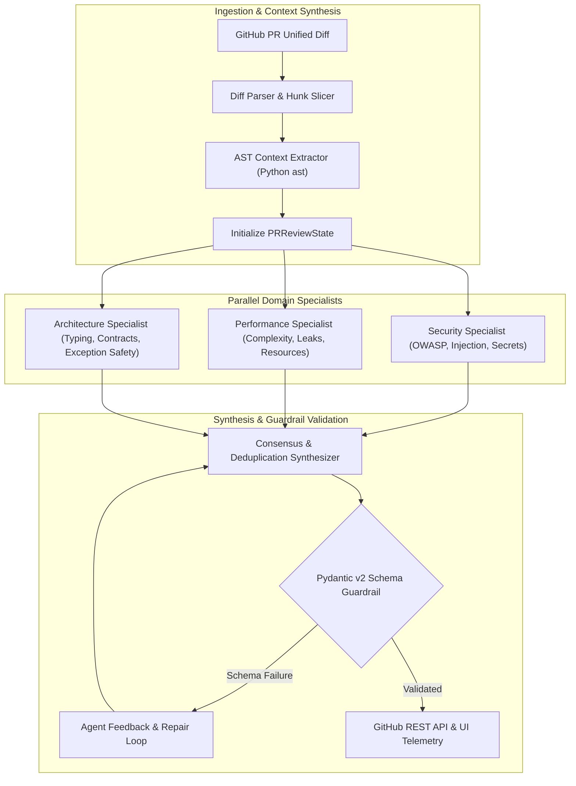

# System Architecture & Technical Specifications

This document outlines the architectural design, agent topology, data contracts, and algorithmic components powering the **Autonomous Multi-Agent PR Reviewer & Security Auditor**.

---

## 1. System Design & Topology

The system is engineered as an event-driven, cyclical state machine that decouples git diff ingestion from semantic and structural code analysis. Rather than issuing a monolithic prompt to a general-purpose LLM, it routes changes through specialized domain agents and validates every output against strict Pydantic v2 schemas.



---

## 2. Multi-Agent State Graph

The agent workflow is implemented using **LangGraph / StateMachine** semantics. The state container (`PRReviewState`) flows deterministically through nodes:

### State Contract (`PRReviewState`)
```python
class PRReviewState(TypedDict):
    diff_text: str
    parsed_files: List[FileDiff]
    ast_contexts: Dict[str, Any]
    pull_request_id: int
    repo_owner: str
    repo_name: str
    security_findings: List[ReviewComment]
    performance_findings: List[ReviewComment]
    architecture_findings: List[ReviewComment]
    final_comments: List[ReviewComment]
    overall_status: Literal["APPROVE", "REQUEST_CHANGES", "COMMENT"]
    summary_markdown: str
    total_token_cost_usd: float
    engine_used: str
    execution_trace: List[Dict[str, Any]]
```

### Specialist Agent Responsibilities
1. **Security Specialist:**
   - Detects CWE-89 (SQL Injection), CWE-78 (OS Command Injection), CWE-798 (Hard-coded Credentials), and insecure deserialization.
   - Evaluates whether raw strings flow into database cursors or subprocess execution sinks.
2. **Performance & Systems Specialist:**
   - Detects unclosed database connections, leaked socket descriptors, un-buffered file I/O, and unindexed N+1 iteration patterns.
   - Enforces context-manager semantics (`with` blocks).
3. **Architecture & Typings Specialist:**
   - Enforces SOLID principles, type annotations, and robust error handling.
   - Flags anti-patterns such as bare `except:` blocks that suppress critical system exceptions.

---

## 3. AST Context Extraction Mechanism

A core failure mode of naive LLM code review is **context blindness**: an LLM presented only with isolated diff hunks lacks visibility into enclosing classes, function signatures, and imported scopes.

The **AST Context Extractor** (`src/parser/ast_analyzer.py`) solves this by:
1. Parsing the source files using Python's native `ast` module into concrete syntax trees.
2. Mapping diff hunk line coordinates `[start_line, end_line]` to enclosing AST parent nodes (`FunctionDef`, `AsyncFunctionDef`, `ClassDef`).
3. Extracting scope metadata (function arguments, decorators, return types, called symbols) and injecting it into agent prompt context.

```
Unified Diff Hunk (Lines 24-28)
       │
       ▼
AST Node Resolver ────────► Enclosing Node: def lookup_user(username: str)
                            Class Scope: None
                            Parameters: ['username']
                            Calls Made: ['sqlite3.connect', 'cursor.execute']
```

---

## 4. Conflict Resolution & Deduplication Algorithm

When multiple specialists analyze the same diff, overlapping findings often occur on identical line numbers (e.g., both Security and Architecture flagging an insecure endpoint).

The **Synthesizer Agent** (`src/agents/synthesizer.py`) runs an algorithmic deduplication pass:
1. **Group by Coordinates:** All findings are grouped by `(file_path, line_number)`.
2. **Severity Weighting:**
   $$\text{Weight}(\text{CRITICAL}) = 100, \quad \text{Weight}(\text{WARNING}) = 50, \quad \text{Weight}(\text{INFO}) = 10$$
3. **Category Priority:**
   $$\text{SECURITY} > \text{PERFORMANCE} > \text{ARCHITECTURE} > \text{BUG\_RISK}$$
4. **Resolution:** The candidate with the highest combined tuple `(SeverityWeight, CategoryPriority)` is promoted, and secondary duplicates are merged into the detailed explanation.
5. **Verdict Computation:**
   - If $\text{count}(\text{CRITICAL}) > 0$ or $\text{count}(\text{WARNING}) \ge 3 \implies \mathbf{REQUEST\_CHANGES}$.
   - If $\text{count}(\text{WARNING}) > 0 \implies \mathbf{COMMENT}$.
   - Else $\implies \mathbf{APPROVE}$.

---

## 5. Dual-Engine Architecture (AST Fallback & BYOK LLM)

To ensure high availability and zero operational barrier, the system operates in two execution modes:

1. **Deterministic AST Engine (Zero-Cost / Offline Mode):**
   - Uses AST visitor passes to detect critical vulnerabilities deterministically without invoking any external API.
   - Runs in $<50\text{ms}$ with $\$0.00$ API cost, perfect for CI/CD gates and offline development.
2. **Multi-Model BYOK Gateway (Full Semantic Mode):**
   - Connects to Google Gemini, OpenAI GPT-4o, Anthropic Claude 3.5 Sonnet, Groq Llama 3.3, or OpenRouter.
   - Enforces Pydantic JSON schema constraints on model outputs.

---

## 6. Security Posture

* **Zero Cloud Credential Storage:** User API keys are held exclusively in browser local storage (`localStorage`) and sent via headers directly to the local daemon. No keys are logged, persisted in databases, or transferred off the user machine.
* **Environment Isolation:** All network operations respect proxy settings, and unit tests execute fully in offline mock mode.
