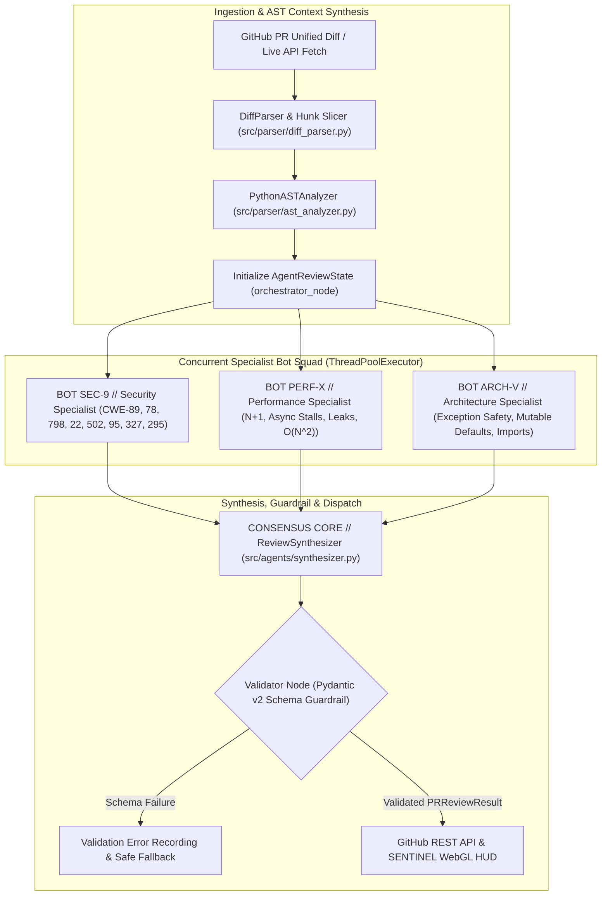

# System Architecture & Technical Specifications

This document outlines the architectural design, multi-agent state graph topology, data contracts, deterministic & LLM rule matrices, and frontend cockpit architecture powering **SENTINEL // Autonomous Multi-Agent PR Reviewer & Security Auditor**.

---

## 1. System Design & Topology

The system is engineered as an event-driven, cyclical state machine (`PRReviewGraph`) that decouples unified git diff ingestion from semantic and structural code analysis. Rather than issuing a monolithic prompt to a general-purpose LLM, it extracts Python AST scope metadata, dispatches changes concurrently across three specialized domain agents using a `ThreadPoolExecutor`, resolves overlapping line findings via a weighted consensus arbiter, and validates every output against strict Pydantic v2 schemas.



---

## 2. Multi-Agent State Graph (`PRReviewGraph`)

The agent workflow is implemented in `src/agents/graph.py` and `src/agents/state.py`. The state dictionary (`AgentReviewState`) flows deterministically through the graph nodes:

### State Contract (`AgentReviewState`)
```python
class AgentReviewState(TypedDict, total=False):
    pull_request_id: int
    repo_owner: str
    repo_name: str
    diff_text: str
    files: List[FileDiff]
    ast_analyses: Dict[str, Any]
    api_key: Optional[str]
    provider: Optional[str]
    model_name: Optional[str]
    active_specialists: List[str]
    security_findings: List[ReviewComment]
    performance_findings: List[ReviewComment]
    architecture_findings: List[ReviewComment]
    synthesized_comments: List[ReviewComment]
    overall_status: Literal["APPROVE", "REQUEST_CHANGES", "COMMENT"]
    summary_markdown: str
    total_token_cost_usd: float
    validation_passed: bool
    validation_errors: List[str]
    iteration_count: int
```

### Specialist Agent Responsibilities & Rule Matrix (`src/agents/specialists.py`)

#### 1. `BOT SEC-9` — Security Specialist (`audit_security`)
Scans modified hunks and AST context for OWASP Top 10 and CWE vulnerabilities:
- **CWE-89 (SQL Injection — `CRITICAL`):** Dynamic SQL construction via f-strings, `%` formatting, `.format()`, or string concatenation (`SELECT`, `INSERT`, `UPDATE`, `DELETE`, `DROP`, `WHERE`).
- **CWE-798 (Hardcoded Credentials — `CRITICAL`):** Plaintext API keys, JWT secrets, AWS Access Key IDs (`AKIA...`), GitHub PATs (`ghp_...`), Stripe live keys (`sk_live_...`), and RSA private keys.
- **CWE-95 (Dynamic Code Execution — `CRITICAL`):** Unsafe `eval()` or `exec()` invocations enabling Remote Code Execution (RCE).
- **CWE-78 (OS Command Injection — `CRITICAL`):** Unsanitized `os.system()`, `os.popen()`, or `subprocess` calls with `shell=True`.
- **CWE-22 (Path Traversal — `CRITICAL`):** Unverified `os.path.join()` or `open()` with user-supplied filenames lacking `os.path.abspath` / boundary checks.
- **CWE-502 (Insecure Deserialization — `CRITICAL`):** Untrusted stream deserialization via `pickle.load(s)` or `yaml.load()` without `SafeLoader`.
- **CWE-327 (Weak Cryptography — `WARNING`):** Collision-vulnerable `hashlib.md5()` or `hashlib.sha1()` usage.
- **CWE-295 (Disabled SSL/TLS Verification — `WARNING`):** HTTP client calls with `verify=False`.

#### 2. `BOT PERF-X` — Performance & Systems Specialist (`audit_performance`)
Analyzes runtime complexity, async concurrency, and resource lifecycle management:
- **Blocking Async Event Loop (`CRITICAL`):** Synchronous `time.sleep()` calls inside `async def` coroutines that stall the entire worker thread.
- **N+1 Query Anti-Pattern (`WARNING`):** Database/ORM queries (`cursor.execute`, `session.query`, `.select`) executed inside `for`/`while` loops.
- **Unclosed Resource Handles (`WARNING`):** Acquiring file handles or DB connections (`open()`, `connect()`, `cursor()`) without `with` context managers.
- **$O(N^2)$ String Concatenation (`INFO`):** Accumulating strings via `+=` inside loops instead of `''.join(...)`.
- **Repeated Regex Compilation (`INFO`):** Calling `re.compile` / `re.search` repeatedly inside iteration loops.

#### 3. `BOT ARCH-V` — Architecture & Typings Specialist (`audit_architecture`)
Enforces clean code standards, exception safety, and modular boundaries:
- **Silent Exception Swallowing (`WARNING`):** Bare `except:` or `except Exception: pass` blocks that mask fatal system errors.
- **Mutable Default Arguments (`WARNING`):** Function definitions using `=[]` or `={}` default parameters that persist state across invocations.
- **Wildcard Imports (`INFO`):** Namespace-polluting `from module import *` statements.
- **Global State Mutation (`INFO`):** Mutating module-level state via the `global` keyword.
- **Hardcoded Localhost Endpoints (`INFO`):** Non-portable `http://localhost` or `127.0.0.1` URLs embedded in application logic.

---

## 3. AST Context Extraction Mechanism (`src/parser/ast_analyzer.py`)

A core failure mode of naive LLM code review is **context blindness**: an LLM presented only with isolated diff hunks lacks visibility into enclosing classes, function signatures, and imported scopes.

The **PythonASTAnalyzer** solves this by:
1. Reconstructing synthetic source from added and context lines in each Python file diff and parsing it with Python's native `ast` module.
2. Indexing all enclosing `FunctionDef`, `AsyncFunctionDef`, and `ClassDef` scopes along with their `[start_line, end_line]` spans, parameter lists, and docstrings.
3. Walking the AST to flag structural hazards (`DANGEROUS_CALL` for `eval`/`exec`, `SQL_INJECTION_RISK` for `ast.JoinedStr` f-strings containing SQL verbs).
4. Injecting the resolved `ASTContext` into the specialist prompts so LLM and deterministic reviewers know the exact enclosing function and scope.

---

## 4. Conflict Resolution & Deduplication Algorithm (`src/agents/synthesizer.py`)

When multiple specialists inspect the same diff, overlapping findings can occur on identical coordinates. The **ReviewSynthesizer** (`CONSENSUS CORE`) executes an algorithmic deduplication pass:

1. **Coordinate Grouping:** Findings from all three specialists are grouped by `(file_path, line_number)`.
2. **Severity Weighting:**
   $$\text{Weight}(\text{CRITICAL}) = 3, \quad \text{Weight}(\text{WARNING}) = 2, \quad \text{Weight}(\text{INFO}) = 1$$
3. **Category Priority:**
   $$\text{SECURITY} > \text{PERFORMANCE} > \text{BUG\_RISK} > \text{ARCHITECTURE}$$
4. **Promotion & Merge:** The candidate with the highest priority tuple is promoted as the primary comment, and distinct explanations from secondary agents on the same line are merged into `detailed_explanation`.
5. **Verdict Computation:**
   - If $\text{count}(\text{CRITICAL}) > 0$ or $\text{count}(\text{WARNING}) \ge 3 \implies \mathbf{REQUEST\_CHANGES}$
   - Else if $\text{count}(\text{WARNING}) > 0$ or $\text{count}(\text{INFO}) > 0 \implies \mathbf{COMMENT}$
   - Else $\implies \mathbf{APPROVE}$

---

## 5. Universal Multi-Provider BYOK Gateway (`src/agents/llm_gateway.py`)

The system operates seamlessly in two modes:
1. **Universal BYOK LLM Mode:**
   - Supports **Google Gemini (`gemini-2.5-flash` / `gemini-2.0-flash`)**, **OpenAI (`gpt-4o-mini` / `gpt-4o`)**, **Anthropic (`claude-3-5-sonnet-20241022`)**, **Groq (`llama-3.3-70b-versatile`)**, and **OpenRouter**.
   - Automatic provider detection from key prefixes (`AIza*` $\to$ Gemini, `sk-ant-*` $\to$ Anthropic, `gsk_*` $\to$ Groq, `sk-or-*` $\to$ OpenRouter, `sk-*` $\to$ OpenAI).
   - Enforces `UNIVERSAL_FINDINGS_SCHEMA` structured JSON output on every model response.
2. **Deterministic AST Engine (Zero-Cost Offline Mode):**
   - Executes in `<20ms` with `$0.00` cloud cost when no API key is supplied or when running in offline CI/CD environments.

---

## 6. Modular Server & SENTINEL Tactical Cockpit UI

### Decoupled Backend Routers (`src/api/`)
- `src/api/app.py`: FastAPI ASGI factory mounting static assets (`/static`), UI routes (`/`, `/ui`), and modular routers.
- `src/api/native_server.py`: Zero-dependency dual-port HTTP server binding simultaneously to ports `8000` and `8080`.
- `src/api/routes/health.py`: Service health and model readiness (`GET /health`).
- `src/api/routes/review.py`: Direct diff review execution (`POST /api/v1/review`).
- `src/api/routes/github.py`: Live GitHub PR diff fetching (`POST /api/v1/github/fetch`) and inline review publishing (`POST /api/v1/github/publish`).

### SENTINEL Frontend Architecture (`src/ui/`)
- **Design System:** Deep Charcoal (`#08090c` canvas, `#0f1117` surface) with Tactical Cyber Amber (`#f59e0b` / `#fbbf24`) accents and `Space Grotesk` + `Plus Jakarta Sans` + `Space Mono` typography.
- **3D WebGL & 2D Robot Sentinel (`SENTINEL-01`):** Interactive Three.js + GSAP robot head that tracks cursor position and animates state transitions (`STANDBY`, `SCANNING`, `APPROVED`, `CHANGES REQUESTED`), paired with an offline CSS Cyber Scanner Visor fallback.
- **Critical Code Vulnerabilities Hotline Deck & Header Hotspots:** Top-level alert cards and diff header chips that jump directly to the offending file and line number with a smooth scroll and row pulse animation.
- **Multi-File Repository Code Navigator:** Interactive file pills (`All Changed Codes` + per-file filter pills with `+add / -del` counts and critical badge indicators) designed for multi-file PR audits such as `Testing SENTINEL (8 Codes)`.
